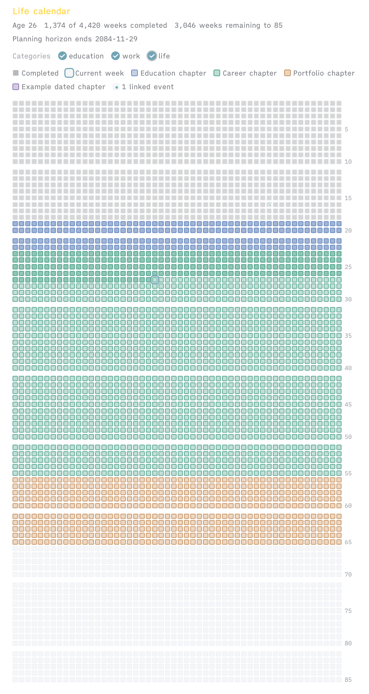
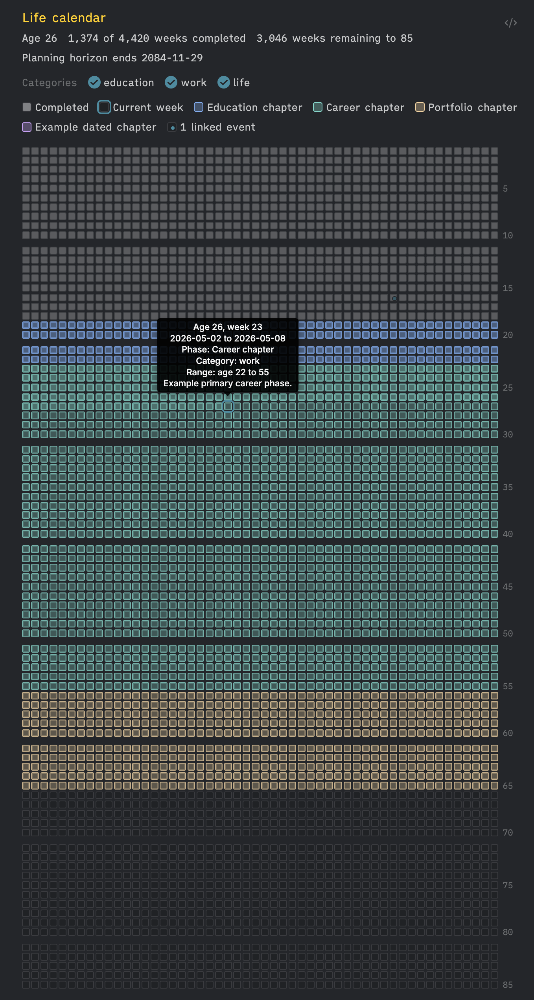

# Life Calendar Plus

An Obsidian plugin that renders a life-in-weeks (*memento mori*) calendar from a `life-calendar` code block: one row per year, 52 squares per row, with completed weeks, the current week, planning phases and linked events.

**Life Calendar Plus is based on [Life Calendar](https://github.com/paulobsf/obsidian-life-calendar) by Paulo Ferreira** (MIT). All of the calendar logic, phases, categories and event handling come from that plugin. This fork adds a few changes on top.

## What it adds compared with Life Calendar

- **Emoji on event weeks.** A week that has an event shows that event's emoji in place of the square, drawn a pixel larger so it stands out, for example `💍 Wedding` or `✈️ First flight`. Weeks whose events have no emoji keep the normal square with the small corner dot, as in the original.
- **Fills the window width.** The calendar uses the whole note width and the note ignores *Readable line length*, so the squares grow with the window. Turn it off per block with `fullWidth: false`.
- **Live updates.** Open calendars redraw when event notes are added, edited, renamed or deleted, for example by a sync. Upstream only draws when the note is opened.
- **More reliable insert command.** **Life Calendar Plus: Insert life calendar block** is registered before settings are loaded. A broken or conflicted `data.json` no longer stops the command, the code block renderer or the settings tab from loading. The block it inserts always starts on its own line.
- **Optional `emoji` field on events.** Set it in a note's frontmatter or on an inline event to choose the emoji yourself.
- **Inline events sorted by date.** Inline-only calendars (`includeVaultEvents: false`) now sort their events by date, so "the first event in a week" is well defined.

It uses its own plugin id (`life-calendar-plus`), so the Community Plugins store never replaces it with the original. It renders the same `life-calendar` code blocks, so your existing notes keep working. **Disable the original Life Calendar plugin while you use this one.** Both plugins try to render `life-calendar` blocks, and only one can.

## Screenshots

These screenshots come from the original plugin. Event weeks in this fork show emoji instead of a small dot.

| Light mode | Dark mode |
| --- | --- |
|  |  |

## Installation

### With BRAT (desktop and iPhone/iPad/Android)

1. Install and enable **BRAT** (Obsidian42 - BRAT) from **Settings → Community plugins → Browse**.
2. Open **Settings → BRAT → Add beta plugin**.
3. Enter `mrjumjum/life-calendar-plus` and pick the latest version.
4. Enable **Life Calendar Plus** under **Settings → Community plugins**. Disable the original **Life Calendar** if it is installed.

BRAT downloads `main.js`, `manifest.json` and `styles.css` from the latest GitHub release and can keep the plugin updated.

### Manual

1. Download `main.js`, `manifest.json` and `styles.css` from the latest [release](https://github.com/mrjumjum/life-calendar-plus/releases).
2. Copy them into `<vault>/.obsidian/plugins/life-calendar-plus/`.
3. Reload Obsidian and enable **Life Calendar Plus** under **Settings → Community plugins**.

The plugin works on desktop and on mobile (`isDesktopOnly: false`).

## Usage

Open a note in **editing mode** (Live Preview or Source mode) and run **Life Calendar Plus: Insert life calendar block** from the command palette. Like every editor command in Obsidian, it only appears in the palette while a Markdown editor is focused, not in Reading view. The command inserts:

````markdown
```life-calendar
title: Life calendar
birthDate: YYYY-MM-DD
lifeExpectancy: 85
showLabelsEvery: 5
showDecadeGaps: true
includeVaultEvents: true
```
````

Replace `YYYY-MM-DD` with your birth date. A fuller example with phases and inline events:

````markdown
```life-calendar
title: My life in weeks
birthDate: 1990-04-12
lifeExpectancy: 90
showLabelsEvery: 5
showDecadeGaps: true
includeVaultEvents: true
hiddenCategories: [sport]
phases:
  - label: School
    category: education
    startDate: 1996-09-01
    endDate: 2008-07-15
  - label: Career
    category: work
    startAge: 22
    endAge: 65
  - label: Later life
    category: life
    startAge: 65
    endAge: 90
    colour: "#7a5aa6"
events:
  - title: 🎓 Graduation
    date: 2012-06-30
  - title: Moved abroad
    emoji: 🇵🇹
    date: 2016-03-01
    link: "[[Moving to Lisbon]]"
```
````

## Code block options

| Option | Type | Description |
| --- | --- | --- |
| `title` | string | Calendar title shown above the grid. |
| `birthDate` | `YYYY-MM-DD` | Date used to work out completed weeks and age rows. Required. |
| `lifeExpectancy` | number | Number of age rows to render (1–130, default `85`). |
| `showLabelsEvery` | number | Interval for the right-hand age labels (1–25). Defaults to the plugin setting, initially `5`. |
| `showDecadeGaps` | boolean | Adds extra space between decades. Defaults to the plugin setting, initially `true`. |
| `includeVaultEvents` | boolean | Includes event notes found in the vault (default `true`). |
| `fullWidth` | boolean | Fills the window width, so the squares scale with it (default `true`). The note holding the calendar ignores Obsidian's *Readable line length*. Set `false` for the original fixed-width grid. |
| `eventProperty` | string | Frontmatter property that marks event notes. Defaults to the plugin setting, initially `life-calendar-event`. |
| `eventDateProperty` | string | Frontmatter property used as the event date. Defaults to the plugin setting, initially `date`. |
| `eventTitleProperty` | string | Frontmatter property used as the event title. Defaults to the plugin setting, initially `title`. |
| `phases` | list | Planning phases: `label`, `category`, `startAge`/`endAge` **or** `startDate`/`endDate`, plus optional `colour`/`color`, `paletteIndex`, `description` and `enabled`. |
| `visibleCategories` | list | Optional allow-list of phase categories. |
| `hiddenCategories` | list | Optional block-list of phase categories. |
| `events` | list | Inline events: `title`, `date`, plus optional `link` (`"[[Note]]"`), `emoji`, `description` and `category`. |

## Vault-backed event notes

Any note becomes an event if its frontmatter has `life-calendar-event: true`, `type: life-event`, or the tag `life-calendar/event`:

```yaml
---
life-calendar-event: true
date: 2019-08-24
title: Wedding 💍
# optional: overrides the emoji found in the title
emoji: 💍
---
```

The title comes from `title` (or the property named by `eventTitleProperty`). If that is missing, the note's file name is used.

## How the emoji is chosen

- **Where it looks:** for each event, in this order: the `emoji` field, the title, and then (for notes only) the file name. The first emoji found wins.
- **What counts as an emoji:** the text is split into user-perceived characters (grapheme clusters, via `Intl.Segmenter`, with a regex fallback). Multi-part emoji therefore stay whole: ZWJ sequences such as 👨‍👩‍👧‍👦 and 👩🏽‍💻, skin tones, flags such as 🇵🇹 and 🏴󠁧󠁢󠁳󠁣󠁴󠁿, keycaps such as 1️⃣, and VS16 forms such as ✈️.
- **What is skipped:** typographic symbols written without VS16 (`©`, `®`, `™`, `‼`, `↔`, `▶`) are ignored. A bare pictograph such as `✈` or `❤` does count, and is shown in emoji style (✈️, ❤️).
- **Several events in one week:** the week shows the emoji of the earliest event that has one. If none of them has an emoji, the week keeps its square and the original corner dot. Every event is still listed in the tooltip and the click menu, and the small corner dot for "multiple events" is kept.

## Customising the look

The emoji sits in an overlay `span.life-calendar-week-emoji` inside the event cell, which gets the class `.has-event-emoji`. Event weeks without an emoji are drawn exactly as in the original plugin. The cell itself is drawn without fill, border or fade, so the emoji takes the square's place. The overlay is transparent and does not capture clicks, so the tooltip, the hover zoom and the click menu work as before. Example CSS snippet:

```css
/* emoji size = scale × cell width + extra (defaults 1 and 2px, i.e. about 1px past each edge) */
.life-calendar { --life-calendar-emoji-scale: 0.9; --life-calendar-emoji-extra: 0px; }
```

## Privacy

Everything runs inside Obsidian. The plugin makes no network requests and uses no telemetry. With vault events enabled it reads frontmatter metadata from your local vault.

## Development

`main.js` is plain CommonJS that Obsidian loads directly, so there is no bundler step.

```sh
npm ci
npm run check    # node --check + TypeScript checkJs against the obsidian typings
npm test         # node:test: emoji extraction + render/registration checks
npm run dist     # copies the plugin files to dist/life-calendar-plus/
```

### Cutting a release

```sh
npm run release -- 1.2.0     # bumps manifest/package/versions.json, runs checks, commits, tags 1.2.0
git push origin main 1.2.0   # the tag triggers .github/workflows/release.yml
```

The workflow checks that the tag matches `manifest.json`, runs the checks, and publishes a GitHub release with `main.js`, `manifest.json` and `styles.css`, which is what BRAT installs. Tags have no `v` prefix, the same as upstream. Don't push upstream's old `1.0.0`/`1.0.1` tags, because the workflow refuses to release them.

## Credits and licence

Based on [paulobsf/obsidian-life-calendar](https://github.com/paulobsf/obsidian-life-calendar) by Paulo Ferreira. MIT licence; see [LICENSE](LICENSE).
